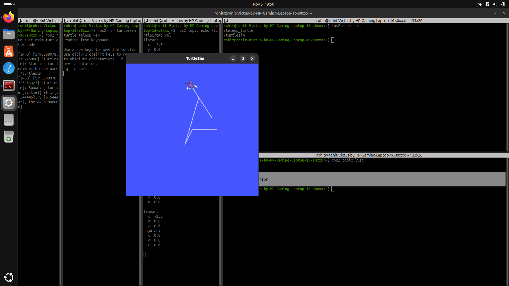

# Dexbot 🤖

A robot I'm building from scratch, one ability at a time, to learn robotics software engineering: **C++, Python and ROS 2 Lyrical** on Ubuntu 26.04.

Dexbot starts as a few lines of code and grows into an autonomous warehouse robot that maps, navigates and delivers packages in simulation.

## Ability ladder
| Stage | Dexbot can… | Status |
| --- | --- | --- |
| v0.1 | Exist, and drive a simulated turtle |✅ Done |
| v0.2 | Calculate its position (odometry) and control speed (PID) | ⏳ |
| v0.3 | Drive itself to any point | ⏳ |
| v0.5 | Take commands and start with one launch command | ⏳ |
| v0.7 | Live in a Gazebo warehouse with LiDAR and a camera | ⏳ |
| v1.1 | Build a map of the warehouse (SLAM) | ⏳ |
| v1.3 | Run delivery missions around moving obstacles | ⏳ |

## Changelog
- **3 Nov 2026:** Dexbot is born. First C++ and Python programs.
- **5 Nov 2026:** v0.1, Dexbot drives trough keyboard(turtlesim)


## Repo layout
- `core/`: Dexbot's core logic in C++ and Python

## Run it
```bash
cd core
g++ hello_dexbot.cpp -o hello_dexbot && ./hello_dexbot
python3 hello_dexbot.py
```
